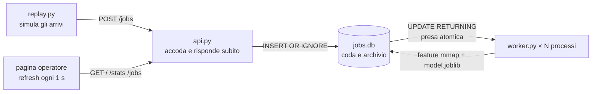

# Diagnosi impianto idraulico sotto carico

Il sistema classifica la perdita interna della pompa su ogni ciclo del dataset UCI
*Condition Monitoring of Hydraulic Systems* e rende il risultato consultabile da un operatore,
anche quando arrivano cicli nuovi mentre altri sono ancora in elaborazione.

| Etichetta | Condizione |
|---|---|
| 0 | nessuna perdita |
| 1 | perdita debole |
| 2 | perdita grave |

L'etichetta riguarda il ciclo misurato, non un guasto futuro. Il target è la colonna 3 di `profile.txt`. Non entra mai tra gli input del modello.

## 1. Diagramma di architettura



`avvia.bat` fa partire questi pezzi. `replay.py` rimanda i cicli del test set. `api.py` scrive il lavoro e risponde senza classificare. Uno o più processi di `worker.py` prendono un lavoro alla volta, calcolano le feature, applicano `model.joblib` e salvano etichetta e tempi. La pagina su `http://127.0.0.1:8000` legge gli stessi record.

## 2. Codice sorgente e istruzioni di esecuzione

| File | Ruolo |
|---|---|
| `comune.py` | configurazione, dataset, 68 feature, coda sqlite |
| `train.ipynb` | download, addestramento, valutazione, salvataggio del modello |
| `model.joblib` | random forest scelto sulla validation |
| `cicli_test.txt` | workload fisso: indici del test set |
| `api.py` | ingresso dei lavori e pagina operatore |
| `worker.py` | classificazione in processi separati |
| `replay.py` | invio a ritmo costante e scrittura delle metriche |
| `test_coda.py` | duplicati, presa esclusiva, ripresa dopo il lease |
| `avvia.bat` | avvio completo: dati, API, worker, pagina e demo |
| `config.ini` | URL del dataset, database, host, porta, worker, lease |
| `risultati/valutazione_modello.txt` | metriche del modello |
| `risultati/esperimenti.csv` | metriche di sistema |

Dipendenze: Python 3 nel PATH, con `numpy`, `scikit-learn` e `joblib`.

```powershell
cd "Hydraulic-System-Diagnosis-Under-Load"
python -m pip install numpy scikit-learn joblib
```

### Avvio automatico

Doppio clic su `avvia.bat`, oppure:

```powershell
.\avvia.bat
```

Lo script, in ordine:

1. scarica il dataset in `data/` se i file non ci sono già (~70 MB la prima volta);
2. legge host e porta da `config.ini`;
3. se `http://127.0.0.1:8000/stats` non risponde, apre due finestre: `api.py` e `worker.py 1`;
4. aspetta che la pagina risponda;
5. apre il browser sulla pagina operatore;
6. invia 20 cicli del test set a 2 al secondo, con un tag nuovo `lancio-aaaammgg-hhmmss`, e aggiunge la riga a `risultati/esperimenti.csv`.

Se l'API è già accesa, non ne avvia una seconda e manda comunque i 20 cicli. Per fermare il programma si chiudono le finestre «API operatore» e «Worker». `model.joblib` e `cicli_test.txt` sono già nel repository. Per rifare addestramento e valutazione si apre `train.ipynb` e si fa Run All.

### Avvio manuale

Tre terminali, da questa cartella:

```powershell
python api.py
python worker.py 1
python replay.py demo 2 20
```

Poi aprire `http://127.0.0.1:8000`. `python test_coda.py` controlla duplicati e lease e non serve per la demo. Host, porta, numero di worker, ritardo artificiale e lease (30 s) stanno in `config.ini`. Per ripartire da una coda vuota cancellare `jobs.db`, `jobs.db-wal` e `jobs.db-shm`.

Argomenti utili:

```powershell
python worker.py 4 0.5          # 4 processi, 0.5 s di ritardo artificiale
python replay.py prova 10 50 "1 worker"   # tag, cicli/s, quanti cicli, nota nel csv
```

Lo stesso tag riusa gli stessi id (`prova-ciclo-12`): un secondo lancio è la prova di input ripetuto.

## 3. Giustificazione delle scelte

| Scelta | Perché |
|---|---|
| sqlite come coda e archivio | un solo componente; la coda sopravvive alla morte di un processo; i risultati restano consultabili |
| API che si limita ad accodare | un arrivo nuovo non aspetta le analisi in corso |
| worker come processi | il calcolo è CPU-bound e i thread Python si bloccano a vicenda per il GIL |
| id scelto dal client e `PRIMARY KEY` | un input ripetuto è ignorato dal database (`INSERT OR IGNORE`) |
| lease di 30 s | un lavoro `in_corso` senza risposta torna disponibile da solo |
| presa con `UPDATE … RETURNING` | due worker non prendono lo stesso lavoro |
| 68 feature (media, deviazione standard, minimo, massimo sui 17 sensori) e random forest | riassunto stabile di un ciclo da 60 s; si confronta con la regressione logistica e con la classe più frequente |
| misure in `.npy` con mmap | i worker condividono la stessa copia dei sensori invece di ricaricarla |

Limiti noti. Il client invia il numero del ciclo e il worker legge le misure da disco: il messaggio non contiene i campioni. Un solo file sqlite regge poche centinaia di scritture al secondo. Un lavoro più lungo del lease può essere ricalcolato; il risultato è deterministico, quindi la ripetizione non cambia l'etichetta. Il worker interrotto ricomincia il ciclo da capo.

## 4. Valutazione del modello

Divisione 60/20/20 stratificata (`random_state=0`): 1323 cicli di training, 441 di validation, 441 di test. Una riga è un ciclo intero, quindi i campioni di uno stesso ciclo non finiscono in due partizioni. Lo scaler sta nella pipeline ed è fittato solo sul training. Il modello si sceglie con la F1 macro sulla validation; il test si usa una volta, per il modello scelto e per il riferimento.

F1 macro sulla validation:

| Modello | F1 macro |
|---|---|
| riferimento (classe più frequente) | 0.237 |
| regressione logistica | 0.988 |
| random forest | 0.997 |

Scelto: random forest. Sul test (441 cicli) la matrice di confusione è diagonale e precision, recall e F1 valgono 1.00 per nessuna perdita (244), perdita debole (99) e perdita grave (98). Il riferimento, che predice sempre «nessuna perdita», ha accuracy 0.55 e F1 macro 0.24. Il report completo è in `risultati/valutazione_modello.txt`.

Limiti della valutazione. I cicli vicini nel tempo si somigliano e una divisione casuale può risultare più facile di una divisione per blocchi temporali. Il banco è uno solo, in laboratorio: i numeri non si trasferiscono a un impianto diverso senza nuovi dati.

## 5. Confronto sperimentale delle configurazioni

Il workload è sempre `cicli_test.txt`. Ogni lancio di `replay.py` aggiunge una riga a `risultati/esperimenti.csv`.

Definizione delle misure:

| Misura | Definizione |
|---|---|
| Lavori unici completati | righe `fatto` con quell'id; un id ripetuto non conta due volte |
| Throughput | lavori fatti / (ultimo `finito` − primo `inviato`), in lavori/s |
| Tempo di calcolo | solo feature + predict (`perf_counter`), in ms; il ritardo artificiale sta nella colonna `ritardo` e non entra qui |
| Tempo end-to-end | `finito` − `inviato`: quanto aspetta l'operatore |
| Lavoro ancora aperto | lavori non `fatto`; `pendenti_a_fine_invio` è il valore nell'istante in cui finisce l'invio |
| Risorse | secondi di CPU dei worker / durata, cioè i core occupati in media |

Run registrati (1 worker, 20 cicli, nessun ritardo artificiale):

| Tag | Arrivi (cicli/s) | Inviati | Duplicati | Completati unici | Throughput (job/s) | Calcolo medio (ms) | Attesa coda (s) | End-to-end medio (s) | p95 (s) | Pendenti a fine invio | Incompleti | Core medi |
|---|---|---|---|---|---|---|---|---|---|---|---|---|
| prova | 10 | 20 | 0 | 20 | 10.67 | 27.72 | 0.535 | 0.577 | 1.264 | 1 | 0 | 0.25 |
| prova (rilancio) | 10 | 20 | 20 | 20 | 10.67 | 27.72 | 0.535 | 0.577 | 1.264 | 0 | 0 | 0.25 |
| demo | 2 | 20 | 0 | 20 | 2.13 | 32.56 | 0.452 | 0.485 | 2.264 | 1 | 0 | 0.05 |
| demo (secondo lancio) | 2 | 20 | 0 | 20 | 2.08 | 63.09 | 0.024 | 0.094 | 0.227 | 1 | 0 | 0.03 |

A 2 e a 10 cicli/s, con 20 cicli, non resta nessun lavoro incompleto. Il throughput segue la velocità di arrivo: con così pochi cicli non si vede ancora il punto in cui la coda cresce senza recuperare. `pendenti_a_fine_invio` vale 1 perché l'ultimo ciclo è ancora in elaborazione quando l'invio termina. Il secondo `demo` ha la stessa velocità e gli stessi 20 cicli, con attesa in coda più bassa (0.024 s) e tempo di calcolo medio 63 ms.

Protocollo per il confronto completo, sempre sullo stesso workload:

1. Funzionamento normale: `python replay.py normale 1 10` con la pagina operatore aperta.
2. Carico crescente, 1 worker: `python replay.py v5 5`, `v20 20`, `v50 50`, `v100 100`, `v200 200`. Il sistema non regge più quando `attesa_coda_media_s` e `pendenti_a_fine_invio` crescono a ogni velocità, cioè quando gli arrivi superano `throughput_job_s`.
3. Capacità: ripetere lo stesso carico con `python worker.py 2`, `4` e `8`, cambiando tag (per esempio `w4-v200`). Il guadagno si ferma ai core fisici e alle scritture su sqlite.

Nel csv allegato ci sono i quattro run della tabella. `avvia.bat` ne aggiunge un altro a ogni doppio clic, con tag `lancio-...`. Le serie di carico e di numero di worker vanno eseguite con i comandi sopra.

## 6. Evidenze: interruzione e input ripetuto

**Input ripetuto.** Il secondo lancio di `python replay.py prova 10` rimanda gli stessi 20 id. L'API risponde `duplicato: true` (HTTP 200 invece di 202). Nel csv i duplicati sono 20, `completati_unici` resta 20 e nessun lavoro viene eseguito due volte. `test_coda.py` verifica lo stesso comportamento sul database: il secondo `INSERT` con la stessa chiave è ignorato.

**Interruzione.** `python test_coda.py` simula la morte del worker: il lavoro resta `in_corso`, dopo il lease (30 s) un altro worker lo riprende e `tentativi` passa a 2. Nessun lavoro accodato viene cancellato. Dal vivo:

```powershell
python worker.py 2 2
python replay.py crash 5 30
```

Interrompere i worker con Ctrl+C a metà. I lavori presi e non chiusi restano `in_corso`. Riavviando `worker.py`, dopo 30 s vengono ripresi (`tentativi` = 2, colonna `ripresi_dopo_crash`). L'unico lavoro ripetuto è quello interrotto, ricalcolato da capo; l'etichetta non cambia. Nel csv attuale `ripresi_dopo_crash` è 0: la prova automatica c'è, il run dal vivo con il tag `crash` non è ancora stato appeso al file.

## 7. Dimostrazione breve

Doppio clic su `avvia.bat`. Si aprono la pagina operatore e, se non erano già attivi, API e worker. Venti cicli passano da `in_coda` a `in_corso` a `fatto`, con una delle tre etichette. La pagina elenca stato, risultato, attesa, tempo di calcolo e tentativi, e si aggiorna ogni secondo.

I due run `demo` già nel csv chiudono entrambi 20 lavori unici, con throughput 2.13 e 2.08 job/s e nessun incompleto. Un lancio di `avvia.bat` fa lo stesso percorso con un tag `lancio-...`.
